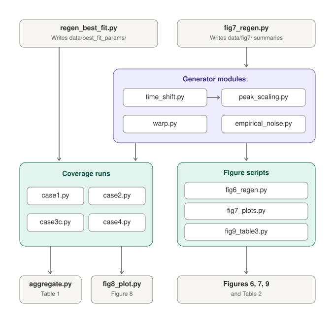

# Stochasticity and Practical Identifiability in Epidemic Models: A Monte Carlo Perspective

Code and data for the paper by Chiara Mattamira and Olivia Prosper Feldman
(Department of Mathematics, University of Tennessee, Knoxville).

The paper compares ways of generating synthetic data for Monte Carlo practical
identifiability analysis of the SIR model: independent Gaussian noise,
empirical residual resampling, direct stochastic (CTMC) simulation, and a
warped ODE whose time shift is drawn from a closed-form distribution.

## Layout

| folder | contents |
|---|---|
| `code/` | Python scripts: the warped-ODE generator, the coverage runs, the figure scripts and the diagnostics |
| `notebooks/` | Jupyter notebooks for the figures that characterize the stochastic noise |
| `data/` | Parameter grid, CTMC trajectories, fitted parameter pairs, and the summaries behind Figure 7 |
| `results/` | Coverage results, one small CSV per parameter combination and method |
| `figures/` | Figures and tables written by the scripts |
| `docs/` | The code map shown below |

## Requirements

Python 3.11 with the packages in `requirements.txt`:

```bash
pip install -r requirements.txt
```

Run the scripts from inside `code/`, since they import one another:

```bash
cd code
```

## Which code produces which figure or table

| item | produced by | notes |
|---|---|---|
| Figure 1 | `notebooks/Fig01_parameter_selection.ipynb` | |
| Figures 2, 4, 5, 12, 13, 14 | `notebooks/Fig02_04_05_12-14_residual_analysis.ipynb` | |
| Figure 3 | `notebooks/Fig03_autocorrelation.ipynb` | |
| Figure 6 | `code/fig6_regen.py` | |
| Figure 7 | `code/fig7_regen.py`, then `code/fig7_plots.py` | the first writes the summaries in `data/fig7/` |
| Figure 8 | `code/case1.py --sigmas ...` through `code/submit_fig8.slurm`, then `code/fig8_plot.py` | cluster job, see below |
| Figure 9 and Table 2 | `code/fig9_table3.py` | |
| Figure 10 | `notebooks/Fig10_control_strategy.ipynb` | |
| Figure 11 | `notebooks/Fig11_curve_registration.ipynb` | |
| Figure 15 | `notebooks/Fig15_variance_vs_mean.ipynb` | |
| Table 1 | `code/case1.py`, `case2.py`, `case3c.py`, `case4.py` through `code/submit_coverage.slurm` | cluster job, results in `results/` |
| Table 3, timing row | `code/timing_benchmark.py` | |
| Table 4 | `code/extinction_table.py` | |

## How the code fits together



An arrow means "is used by" or "feeds". The purple box holds the shared modules
that other files import; the green boxes hold the scripts you run. Arrows are
drawn between groups; the exact connections for each file are:

| script | imports | reads | writes |
|---|---|---|---|
| `regen_best_fit.py` | none | `params_combos.csv` | `data/best_fit_params/` |
| `fig7_regen.py` | none | `params_combos.csv` | `data/fig7/` summaries and samples |
| `peak_scaling.py` | `time_shift` | `data/fig7/` summaries | none (module) |
| `case1.py` | none | `best_fit_params/` | `results/case1/`, Figure 8 results |
| `case2.py` | none | `best_fit_params/`, `ctmc_trajectories/` | `results/case2/` |
| `case3c.py` | none | `best_fit_params/` | `results/case3c/` |
| `case4.py` | `time_shift`, `peak_scaling`, `warp` | `best_fit_params/`, `data/fig7/` | `results/case4/` |
| `fig6_regen.py` | `time_shift`, `peak_scaling`, `warp`, `empirical_noise` | `ctmc_trajectories/`, `data/fig7/` | Figure 6 |
| `fig7_plots.py` | `time_shift` | `data/fig7/` | Figure 7 |
| `fig9_table3.py` | `time_shift`, `peak_scaling`, `warp` | `data/fig7/` | Figure 9, Table 2 |
| `aggregate.py` | none | `results/` | Table 1 |
| `fig8_plot.py` | none | Figure 8 results, `results/case1/` | Figure 8 |

Three things the diagram simplifies:

- Of the coverage runs, only `case4.py` imports the generator modules. The
  other three are self-contained and only read the fitted pairs.
- `case2.py` carries its own copy of the residual lookup. `empirical_noise.py`
  is the same code as a module, used by `fig6_regen.py` and checked against
  `case2.py` by `verify_extraction.py`.
- Not drawn: `timing_benchmark.py` (imports `fig7_regen` and the three
  warped-ODE modules), `extinction_table.py` (imports `regen_best_fit`), the
  diagnostic scripts, and the notebooks, which read only `params_combos.csv`
  and `ctmc_trajectories/`.

## Commands

Figures 6, 7 and 9, the timing comparison and the extinction table run on a
laptop:

```bash
python fig6_regen.py --params ../data/params_combos.csv --ctmc ../data/ctmc_trajectories \
    --summary ../data/fig7/summary_N1000.csv --out ../figures

python fig7_regen.py --params ../data/params_combos.csv --out ../data/fig7 --trajectories 1000
python fig7_plots.py

# all 4000 fits, a few minutes:
python fig9_table3.py --summary ../data/fig7/summary_N1000.csv --out ../figures
# or redraw from the saved fits:
python fig9_table3.py --summary ../data/fig7/summary_N1000.csv --replot ../data/Fig9_fits.npz --out ../figures

python timing_benchmark.py --summary ../data/fig7/summary_N1000.csv
python extinction_table.py --params ../data/params_combos.csv
```

The coverage table and Figure 8 need a cluster. One coverage number is
100 fitted pairs times 1000 synthetic datasets, about 100,000 model fits.
`submit_coverage.slurm` and `submit_fig8.slurm` are SLURM array jobs with one
task per line of `manifest.tsv` and `fig8_manifest.tsv`; set your account,
environment name and the path to this repository at the top of each. To try a
single task locally with a small number of synthetic datasets:

```bash
python case1.py --combo 9 --bootstrap 6 --seed 7 --data ../data --out /tmp/coverage_test
python case4.py --combo 9 --bootstrap 6 --seed 7 --data ../data --out /tmp/coverage_test \
    --scaling-route parametric --scaling-summary ../data/fig7/summary_N1000.csv
```

When the array jobs have finished:

```bash
python aggregate.py ../results ../figures/coverage_table.csv
python fig8_plot.py --results ../results/fig8_M1000 ../results/case1 --out ../figures
```

## The code in `code/`

| file | purpose |
|---|---|
| `time_shift.py` | Time shift of the warped ODE, drawn from the branching-process limit; closed form, nothing fitted |
| `peak_scaling.py` | Amplitude scaling factor of the warped ODE, calibrated from CTMC simulations |
| `warp.py` | Applies the shift and scaling to the ODE solution |
| `empirical_noise.py` | Residual lookup for the empirical resampling method |
| `regen_best_fit.py` | Steps 1 and 2 of the coverage protocol: simulate realizations conditioned on a major outbreak and fit the ODE to each |
| `case1.py` | Coverage, independent Gaussian noise |
| `case2.py` | Coverage, empirical residual resampling |
| `case3c.py` | Coverage, CTMC conditioned on a major outbreak |
| `case3.py` | Coverage, CTMC without conditioning at the bootstrap step; superseded by `case3c.py` and kept so that `manifest.tsv` stays complete |
| `case4.py` | Coverage, warped ODE |
| `aggregate.py` | Gathers the per-task coverage files into one table |
| `kde_calibration.py` | Calibrates the confidence-region estimator on data where the coverage is known |
| `compare_estimators.py` | Recomputes coverage from saved bootstrap samples under three region rules |
| `validate_case4.py`, `rho_sensitivity.py` | Spread of fitted parameters under each generator, and its sensitivity to a shift-amplitude correlation |
| `noise_effect.py` | Effect of the autoregressive noise term used in an earlier version of the warped generator |
| `verify_extraction.py` | Checks that `empirical_noise.py` reproduces the lookup inside `case2.py` |

## Data

- `data/params_combos.csv`: the 16 parameter combinations.
- `data/ctmc_trajectories/`: 1000 CTMC trajectories per combination at N = 1000,
  used by the notebooks, by Figure 6 and by the empirical resampling method.
  These were generated without a random seed and are provided as data.
- `data/best_fit_params/`: for each combination, the 100 fitted parameter pairs
  from which synthetic data are generated in the coverage protocol
  (written by `regen_best_fit.py`).
- `data/fig7/`: summaries and per-trajectory samples of the time shift and
  amplitude scaling factor at N = 100, 1000 and 10,000 (written by `fig7_regen.py`).
- `data/Fig9_fits.npz`: the fitted parameters plotted in Figure 9.

## Reproducibility notes

- Every script in `code/` is seeded. The seeds of the coverage runs are in
  `manifest.tsv` and `fig8_manifest.tsv`.
- The notebooks are not seeded, so figures that involve random draws
  (Figures 3 and 10, for example) change slightly from run to run.
  `notebooks/CTMC_data_generation.ipynb` is the notebook that originally
  produced the trajectories in `data/ctmc_trajectories/`; it writes to
  `data/regenerated_ctmc_trajectories/` so that it cannot overwrite them.
- The notebooks were written in Google Colab. The only changes made to them
  here are to file paths, the removal of the Colab drive mount, and one line in
  the Figure 3 notebook that now selects its parameter combination by value
  instead of by position.
- Negative simulated values under Gaussian noise are not truncated anywhere.

## License

MIT, see `LICENSE`.
